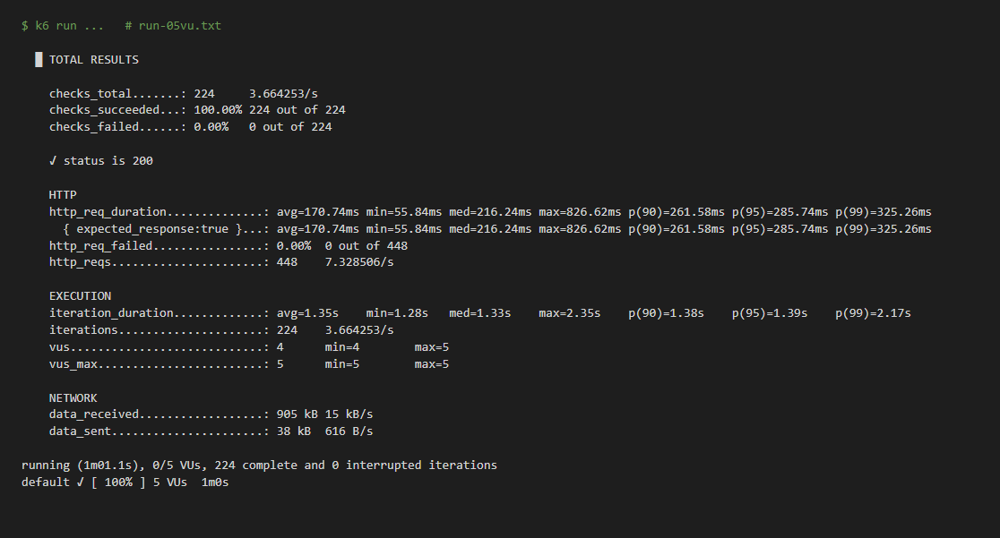
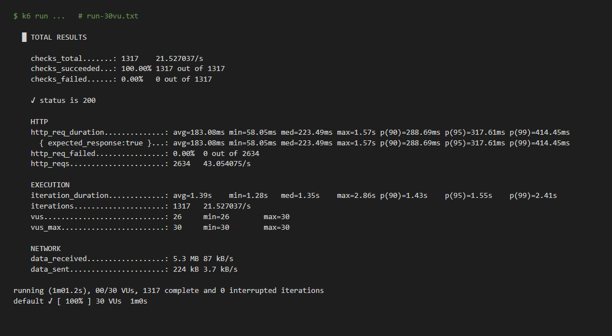
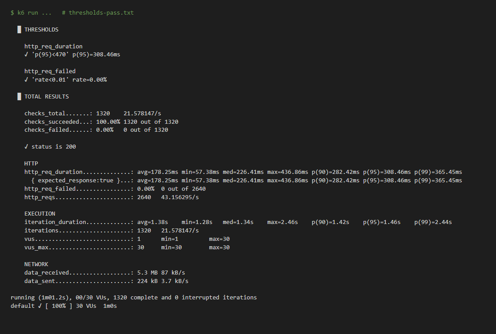
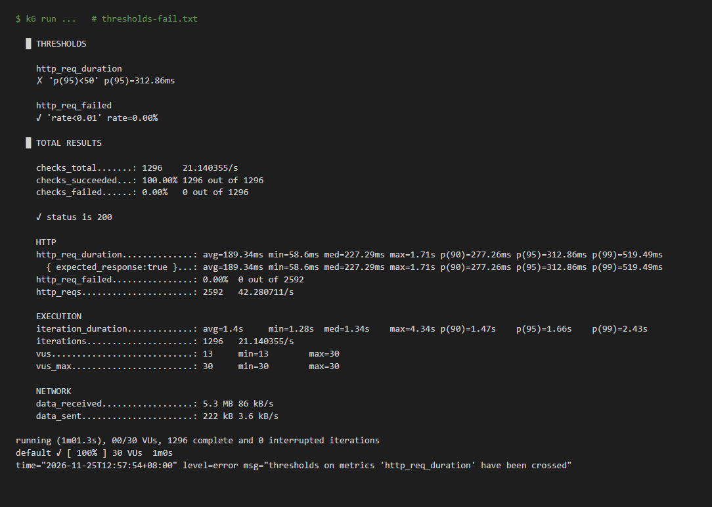
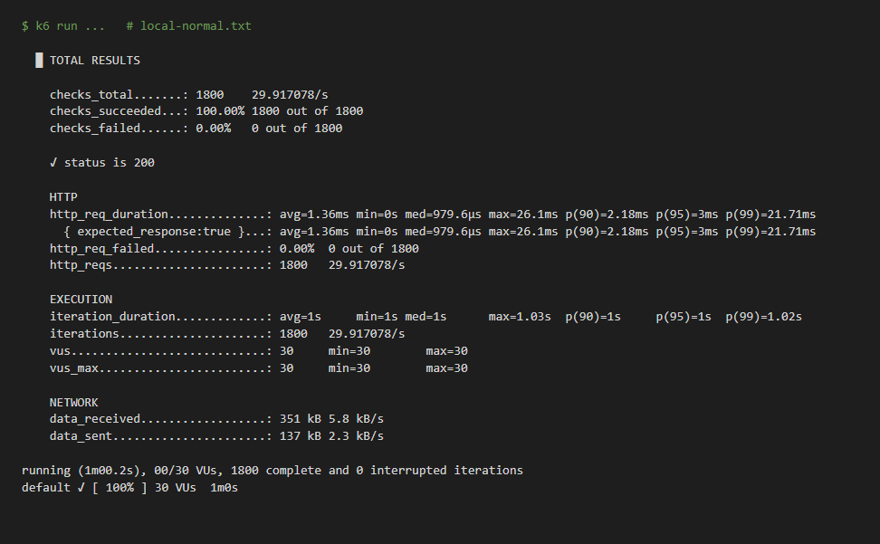

# Лаборатори №2: Гүйцэтгэлийн хэмжүүрийг k6-аар хэмжих

F.CSA313 — 2026

- **Оюутан:** Ө.Манлайбаяр
- **Код:** B222270080

## 1. Орчин ба k6 суулгалт

Windows 11 дээр `winget install --id GrafanaLabs.k6 -e` командаар суулгав.

```
$ k6 version
k6.exe v2.4.0 (commit/dd9395906d, go1.26.11, windows/amd64)
```

(`results/k6-version.txt`)

Тест хийсэн хаягууд: зөвхөн `https://test.k6.io` (k6-ийн албан ёсны туршилтын сайт) болон `http://127.0.0.1:3000` (өөрийн локал сервер).

## 2. Файлын бүтэц

| Файл | Зориулалт |
|---|---|
| `script.js` | Алхам 2: суурь тест (5 VU, 30s, status 200 check, sleep 1) |
| `load-levels.js`, `run-levels.sh` | Алхам 3: 5 / 30 / 100 VU-ийг тус бүр 1 минут |
| `stages.js` | Алхам 3: 30s→5, 1m→30, 30s→100, 30s→0 |
| `thresholds.js` | Алхам 4: SLO PASS (30 VU, 1m) |
| `thresholds-strict.js` | Алхам 4: зориуд хатуу босго, FAIL |
| `server/server.js`, `local-compare.js` | Алхам 5: локал Node сервер (`/normal`, `/slow`=100ms) |
| `tools/render-screenshots.js` | `results/*.txt`-ээс screenshot PNG үүсгэнэ (Edge headless) |
| `results/` | k6-ийн бүрэн гаралт (UTF-8) |
| `screenshots/` | k6 summary-ийн зургууд |

Ажиллуулсан командууд (Git Bash):

```bash
mkdir -p results
k6 run script.js | tee results/baseline-05vu-30s.txt
bash run-levels.sh            # run-05vu.txt, run-30vu.txt, run-100vu.txt
k6 run stages.js > results/stages.txt
k6 run thresholds.js > results/thresholds-pass.txt
k6 run thresholds-strict.js > results/thresholds-fail.txt
node server/server.js &
k6 run -e ENDPOINT=normal local-compare.js | tee results/local-normal.txt
k6 run -e ENDPOINT=slow   local-compare.js | tee results/local-slow.txt
```

Алхам 3-аас хойш p99-ийг харахын тулд `--summary-trend-stats "avg,min,med,max,p(90),p(95),p(99)"` нэмсэн.

> Тэмдэглэл: `https://test.k6.io` нь `302 Found` чиглүүлэлт буцаадаг тул нэг iteration-д 2 HTTP хүсэлт (`http_reqs` = 2 × `iterations`) бүртгэгддэг.

## 3. Үр дүн — test.k6.io

| Тест | VU | Хугацаа | p90 | p95 | p99 | Throughput (http_reqs/s) | Алдааны хувь (http_req_failed) | Файл |
|---|---|---|---|---|---|---|---|---|
| Baseline | 5 | 30s | 267.66ms | 313.44ms | — | 6.606685/s | 0.00% (0 / 206) | `results/baseline-05vu-30s.txt` |
| Ачаалал 1 | 5 | 1m | 261.58ms | 285.74ms | 325.26ms | 7.328506/s | 0.00% (0 / 448) | `results/run-05vu.txt` |
| Ачаалал 2 | 30 | 1m | 288.69ms | 317.61ms | 414.45ms | 43.054075/s | 0.00% (0 / 2634) | `results/run-30vu.txt` |
| Ачаалал 3 | 100 | 1m | 288.24ms | 311.7ms | 359.09ms | 139.590858/s | 0.00% (0 / 8558) | `results/run-100vu.txt` |
| Stages | 0→5→30→100→0 | 2m30s | 289.81ms | 318.62ms | 556.29ms | 43.642618/s | 0.00% (0 / 6592) | `results/stages.txt` |

Бүх тестэд `status is 200` check 100% амжилттай.

## 4. Threshold / SLO

```js
thresholds: {
  http_req_duration: ['p(95)<470'],
  http_req_failed:   ['rate<0.01'],
}
```

**SLO-гийн үндэслэл:** Суурь тестийн (5 VU) p95 = 313.44ms байсан тул ачаалал 30 VU болоход хэрэглэгчийн мэдрэх хариу ихдээ 1.5 дахин удааширч болно гэж үзээд p95 < 313.44 × 1.5 ≈ **470ms** гэж тогтоов. Алдааны хувь (POFOD-тай төстэй хэмжүүр) 1%-иас бага байх нь вэб үйлчилгээний түгээмэл шаардлага тул `rate<0.01` гэж авав.

| Тест | Босго | Хэмжсэн утга | Үр дүн | Файл |
|---|---|---|---|---|
| PASS (30 VU, 1m) | `p(95)<470` | p(95)=308.46ms | ✓ PASS | `results/thresholds-pass.txt` |
|  | `rate<0.01` | rate=0.00% | ✓ PASS |  |
| FAIL (30 VU, 1m) | `p(95)<50` | p(95)=312.86ms | ✗ FAIL (exit code 99) | `results/thresholds-fail.txt` |
|  | `rate<0.01` | rate=0.00% | ✓ PASS |  |

FAIL хувилбарт k6 `thresholds on metrics 'http_req_duration' have been crossed` гэж бичээд 99 кодоор гарсан — CI/CD-д ийм тест pipeline-ийг зогсооно.

## 5. Нэмэлт: локал сервер (normal vs slow)

`server/server.js` — Node.js стандарт сан, нэмэлт хамааралгүй. `/normal` шууд, `/slow` 100ms хүлээгээд хариулна. 30 VU, 1 минут.

| Endpoint | p90 | p95 | p99 | Throughput (http_reqs/s) | Алдааны хувь | Файл |
|---|---|---|---|---|---|---|
| `/normal` | 2.18ms | 3ms | 21.71ms | 29.917078/s | 0.00% (0 / 1800) | `results/local-normal.txt` |
| `/slow` | 115.51ms | 116.3ms | 118.92ms | 27.03992/s | 0.00% (0 / 1650) | `results/local-slow.txt` |

100ms саатал p95-ийг ~3ms-ээс 116.3ms болгож, iteration бүр урт болсон тул (sleep 1s + хариу) ижил 30 VU-тэй үед throughput 29.92/s-ээс 27.04/s болж буурсан — хоцрогдол нэмэгдэхэд throughput буурдгийг (Little-ийн хууль: throughput = VU / iteration хугацаа) шууд харуулж байна.

## 6. Screenshots

| | |
|---|---|
| Baseline  | 5 VU  |
| 30 VU  | 100 VU  |
| Stages  | Threshold PASS  |
| Threshold FAIL  | Локал normal  |
| Локал slow  | |

## 7. Дүгнэлт

Ачааллыг 5 VU-ээс 30, 100 VU хүртэл өсгөхөд throughput 7.33/s → 43.05/s → 139.59/s болж VU-ийн тоотой бараг шугаман өссөн нь test.k6.io (CloudFront CDN-ийн ард) энэ ачаалалд ханаагүй байгааг харуулж байна. Үүний зэрэгцээ p95 хоцрогдол 285.74ms → 317.61ms → 311.7ms гэж бараг өөрчлөгдөөгүй тул систем "өвдөг" (knee) цэгтээ хүрээгүй, latency–throughput-ийн тэнцвэр алдагдаагүй байна. Харин p99 буюу сүүлний хоцрогдол 325.26ms-ээс 414.45ms хүртэл, stages тестэд 556.29ms болж өссөн нь ачаалал нэмэгдэхэд эхлээд tail latency муудаж, дундаж ба медиан үүнийг нууж чаддагийг батлав. Иймээс лекцэд заасанчлан гүйцэтгэлийг дунджаар биш p95/p99 перцентилээр үнэлэх нь зөв юм. Бүх тестэд `http_req_failed` 0.00%, check 100% байсан тул бүтэлгүйтлийн магадлал (POFOD) энэ хэмжээний ачаалалд 0 гэж үзэж болно. Суурь p95 × 1.5 аргаар тогтоосон SLO (p95<470ms, алдаа<1%) 30 VU-д p95=308.46ms-ээр биелж PASS болсон. Зориуд бодит бус хатуу p95<50ms босго тавихад FAIL болж k6 99 кодоор гарсан нь threshold-ыг CI-д чанарын хаалга болгон ашиглаж болохыг харуулав. Локал серверийн туршилтад 100ms саатал нэмэхэд p95 3ms-ээс 116.3ms болж, ижил VU-д throughput 29.92/s-ээс 27.04/s болж буурсан нь хоцрогдол ба throughput-ийн урвуу хамаарлыг (Little-ийн хууль) баталлаа. Алсын тестийн хоцрогдлын ихэнх хэсэг (~200–300ms) сүлжээний зай, TLS ба чиглүүлэлтээс үүдэлтэй байсан бол локалд энэ нь 3ms орчим байсан нь хэмжилтийн орчин үр дүнд хүчтэй нөлөөлдгийг харуулж байна. Цаашид системийн жинхэнэ хязгаарыг олохын тулд 100 VU-ээс илүү stress тест эсвэл өөрийн удирдлагатай серверт хийх шаардлагатай.
